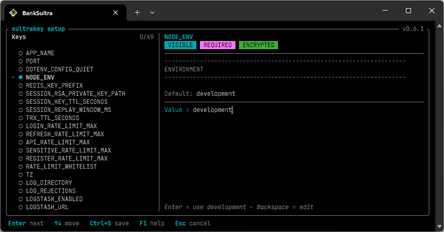

<div align="center">

# 🔐 sultrakey

**File `.env` terenkripsi, plus launcher yang menjalankan aplikasi dengan nilai yang sudah di-decrypt.**

Node.js · PHP · CodeIgniter · Spring Boot · Go · Rust · apa saja yang membaca environment variable

[](https://github.com/banksultra/sultrakey-releases/releases/latest)
[](LICENSE)
[](https://age-encryption.org)
[](https://github.com/banksultra/sultrakey-releases/releases/latest)

<br>



<br>

[Install](#install) ·
[Quick start](#quick-start) ·
[Template](#template-envexample) ·
[Perintah](#perintah) ·
[Per bahasa](#cara-pakai-per-bahasa) ·
[pm2](#pm2) ·
[Docker](#docker) ·
[Update](#update)

</div>

---

## Install

Windows (PowerShell, tanpa hak Administrator):

```powershell
powershell -ExecutionPolicy Bypass -c "irm https://github.com/banksultra/sultrakey-releases/releases/latest/download/install.ps1 | iex"
```

Linux / macOS:

```sh
curl -fsSL https://github.com/banksultra/sultrakey-releases/releases/latest/download/install.sh | sh        # laptop
curl -fsSL https://github.com/banksultra/sultrakey-releases/releases/latest/download/install.sh | sudo sh   # server → /usr/bin
```

Mau versi tertentu: `... | SULTRAKEY_VERSION=0.6.1 sh` (Windows: set dulu `$env:SULTRAKEY_VERSION = '0.6.1'`).
Release dimulai dari 0.6.1.

Cek hasilnya dengan `sultrakey --version`.

## Quick start

1. Di repo aplikasi, siapkan `.env.example` berisi semua variabel (nilainya kosong, atau default yang bukan rahasia).
2. Masukkan `.env` dan `.env.lock` ke `.gitignore`. Jangan pakai pola `.env*`, nanti `.env.example` ikut ke-ignore.
3. `sultrakey init <app>` bikin key dan `.env` dari template.
4. `sultrakey setup` menanyakan variabel yang masih kosong, lalu menyimpannya terenkripsi.
5. `sultrakey check` memastikan semua variabel terisi dan bisa di-decrypt.
6. `sultrakey run -- <perintah>` men-decrypt nilainya, lalu menjalankan aplikasi.

Windows:

```powershell
cd C:\projects\contoh-app
sultrakey init contoh-app
sultrakey setup
sultrakey run -- npm run dev
```

Linux / macOS (bikin key butuh sudo, di laptop juga; key disimpan di `/etc/sultrakey/`):

```sh
sudo sultrakey init contoh-app --owner $USER
sultrakey setup
sultrakey run -- npm run dev
```

Nama aplikasi hanya boleh huruf kecil, angka, dan tanda strip (`-`).

## Template (`.env.example`)

```env
# Port aplikasi
# @plain
PORT=8899
# Host Redis, tanpa http:// dan port. Contoh: 10.10.1.20
REDIS_HOST=
# Password dari admin Redis. Kosongkan kalau tidak ada.
# @optional
REDIS_PASSWORD=
```

- Komentar di atas variabel jadi keterangannya di layar `setup`.
- Tanpa anotasi, variabel dianggap **rahasia dan wajib**: dienkripsi, dan harus terisi sebelum `run`.
- Nama variabel hanya boleh huruf, angka, dan `_`, dan tidak boleh diawali angka. Nama pakai titik seperti
  `database.default.hostname` (gaya CodeIgniter) tidak bisa. Pakai `DB_HOST`.
- Anotasi ditulis di komentar tepat di atas variabel:

| Anotasi       | Efek                                                                                       |
| ------------- | ------------------------------------------------------------------------------------------ |
| `# @plain`    | Disimpan apa adanya, tidak dienkripsi. Cocok untuk port, log level, dan nilai non-rahasia.             |
| `# @optional` | Boleh kosong. Aplikasi menerima string kosong.                                              |
| `# @masking`  | Diketik sebagai `*` dan diisi dua kali. Untuk rahasia yang namanya tidak terdengar rahasia (`DATABASE_URL`). |

- Nilai di template jadi default untuk variabel biasa. Untuk variabel rahasia, nilainya diabaikan dan harus diketik.
- Kosongkan nilai contoh seperti `SMTP_HOST=smtp.example.com`. Kalau tidak, contoh itu ikut tersimpan sebagai nilai asli.
- Nilai panjang (misalnya sertifikat): di `setup` ketik `@/path/ke/file`, atau jalankan `sultrakey set KEY --file <path>`.

## Perintah

| Perintah                            | Fungsi                                                                                     |
| ----------------------------------- | ------------------------------------------------------------------------------------------ |
| `init <app> [--owner user[:group]]` | Bikin key (tidak pernah menimpa yang sudah ada) dan `.env`. Bisa juga mengenkripsi `.env` lama yang masih polos. |
| `setup`                             | Mengisi variabel kosong dalam satu layar. F1 = bantuan, Esc = batal.                       |
| `set <KEY> [--stdin \| --file F]`   | Mengganti satu nilai. Nilai tidak pernah dibaca dari argumen.                             |
| `list`                              | Menampilkan nama variabel dan statusnya. Nilainya tidak pernah ditampilkan.                   |
| `check`                             | Memeriksa semua variabel terisi, bisa di-decrypt, dan key-nya cocok.                                      |
| `run [--env F] -- <cmd> [args]`     | Menjalankan `check`, lalu start aplikasi dengan nilainya.                            |
| `install` / `update` / `uninstall`  | Install, update, dan hapus binary sultrakey.                                                        |

Opsi global: `--env` (bawaan `./.env`), `--template` (bawaan `./.env.example`), `--key-file`.

Key dicari berurutan di:

1. `--key-file`
2. `SULTRAKEY_KEY_FILE`
3. `$CREDENTIALS_DIRECTORY/sultrakey.key` (systemd `LoadCredential=`)
4. `/etc/sultrakey/<app>.key` (Windows: `%APPDATA%\sultrakey\<app>.key`)

Exit code: `0` berhasil, `64` salah pemakaian, `78` masalah konfigurasi, `1` lainnya.
Exit code `78` dipakai pm2 dan systemd sebagai tanda untuk berhenti me-restart aplikasi.

## Cara kerja `run`

- Aplikasi **tidak perlu diubah**. Ia tetap baca environment variable seperti biasa.
- Linux/macOS: sultrakey menggantikan dirinya dengan proses aplikasi (`exec`). PID, sinyal stop, dan exit code langsung ke aplikasi.
- Windows: aplikasi jalan sebagai child process. Ctrl+C tetap sampai ke aplikasi. Kalau terminal ditutup paksa, aplikasi ikut berhenti.
- Nilai dari `.env` menang atas environment yang sudah ada. Kalau bentrok, muncul warning berisi nama variabelnya saja.
- Variabel `@optional` yang kosong dikirim sebagai string kosong.
- Variabel berawalan `SULTRAKEY_` tidak diteruskan ke aplikasi.

## Cara pakai per bahasa

Polanya sama untuk semua: tambahkan `sultrakey run --` di depan perintah start aplikasi.

### Node.js

```sh
sultrakey run -- node dist/main.js
sultrakey run -- npm run dev
```

```js
const host = process.env.REDIS_HOST;
```

- `dotenv` biasa (tanpa `override: true`) aman dipakai. Kalau pakai `override: true`, aplikasi akan membaca teks `enc:...` sebagai nilainya.
- SvelteKit (adapter-node): pakai `import { env } from '$env/dynamic/private'`, lalu `env.REDIS_HOST`. Jangan pakai `$env/static/*`.
- Vite `import.meta.env` dan Next.js `NEXT_PUBLIC_*` dibaca saat build. Nilainya ikut masuk ke hasil build dan bisa sampai ke browser. Jangan taruh rahasia di sana.

### PHP

Variabel masuk lewat environment, jadi bacanya pakai `getenv()`.

```sh
sultrakey run -- php artisan serve     # Laravel
sultrakey run -- php -S 0.0.0.0:8000 -t public
```

```php
$host = getenv('REDIS_HOST');
```

- `$_ENV` hanya terisi kalau `variables_order` di `php.ini` memuat `E` (contoh: `"EGPCS"`). `getenv()` selalu bisa.
- PHP-FPM: jalankan lewat sultrakey, lalu matikan `clear_env`:

  ```sh
  sultrakey run -- php-fpm -F
  ```

  ```ini
  ; pool php-fpm (www.conf)
  clear_env = no
  ```

  Tanpa `clear_env = no`, PHP-FPM membuang semua variabel, jadi aplikasi tidak menerima apa pun.

- Apache `mod_php`, atau nginx + FPM yang sudah jalan sebagai service biasa, tidak lewat sultrakey. Jalankan php-fpm
  lewat sultrakey seperti di atas, di bawah systemd atau Docker.

### CodeIgniter 4

```sh
sultrakey run -- php spark serve
sultrakey run -- php-fpm -F        # produksi, dengan clear_env = no
```

Di `.env.example`, pakai nama dengan underscore, bukan titik:

```env
# @plain
CI_ENVIRONMENT=production
DB_HOST=
DB_NAME=
DB_USER=
DB_PASS=
```

Baca dengan `env()` di `app/Config/Database.php` (isi lewat constructor):

```php
public function __construct()
{
    parent::__construct();
    $this->default['hostname'] = env('DB_HOST');
    $this->default['database'] = env('DB_NAME');
    $this->default['username'] = env('DB_USER');
    $this->default['password'] = env('DB_PASS');
}
```

- CI4 juga membaca file `.env` miliknya sendiri. File itu adalah `.env` dari sultrakey, jadi isinya `enc:...`.
  CI4 tidak menimpa variabel yang sudah ada di environment, jadi yang dipakai tetap nilai dari sultrakey. Aman selama
  aplikasi dijalankan lewat `sultrakey run`.
- Jangan jalankan CI4 tanpa sultrakey dengan `.env` ini. Aplikasi akan membaca `enc:...` sebagai nilainya.

### Spring Boot

```sh
sultrakey run -- java -jar app.jar
sultrakey run -- mvnw.cmd spring-boot:run     # Windows
sultrakey run -- ./mvnw spring-boot:run       # Linux/macOS
```

```properties
# application.properties
spring.data.redis.host=${REDIS_HOST}
spring.data.redis.password=${REDIS_PASSWORD:}
```

- Spring Boot otomatis membaca environment variable. `REDIS_HOST` juga nyambung ke `spring.data.redis.host` lewat relaxed binding.
- `${REDIS_PASSWORD:}` artinya default-nya kosong, cocok untuk variabel `@optional`.

### Golang

```sh
sultrakey run -- go run .
sultrakey run -- ./app
```

```go
host := os.Getenv("REDIS_HOST")
```

### Rust

```sh
sultrakey run -- cargo run
sultrakey run -- ./target/release/app
```

```rust
let host = std::env::var("REDIS_HOST")?;
```

Mau cek konfigurasi tanpa menjalankan aplikasi? Pakai `sultrakey check`.

## pm2

Syarat: Linux, aplikasi jalan sebagai user sendiri (bukan root), dan `sultrakey` ter-install di `/usr/bin` (install pakai `sudo`).

Simpan sebagai `ecosystem.config.js` di folder aplikasi:

```js
module.exports = {
  apps: [
    {
      name: "contoh-app",
      cwd: "/opt/contoh-app",
      script: "/usr/bin/sultrakey",
      args: ["run", "--", "/usr/bin/node", "dist/main.js"],
      interpreter: "none",
      exec_mode: "fork",
      instances: 1,
      autorestart: true,
      stop_exit_codes: [78],
      max_restarts: 10,
      restart_delay: 3000,
    },
  ],
};
```

| Baris                               | Alasan                                                                                     |
| ----------------------------------- | ------------------------------------------------------------------------------------------ |
| `script: '/usr/bin/sultrakey'`      | pm2 menjalankan sultrakey, bukan node langsung.                                            |
| `interpreter: 'none'`               | sultrakey bukan file JavaScript. Tanpa ini pm2 gagal start.                       |
| `exec_mode: 'fork'`, `instances: 1` | Mode cluster tidak bisa dipakai.                                                           |
| `cwd`                               | Folder tempat `.env` berada.                                                               |
| `stop_exit_codes: [78]`             | Kalau konfigurasi salah (password kosong, key salah), pm2 berhenti dan tidak restart terus-menerus. |

Jalankan sebagai user aplikasi:

```sh
sudo -u contoh-app -H pm2 start /opt/contoh-app/ecosystem.config.js
sudo -u contoh-app -H pm2 logs contoh-app --lines 50
```

Supaya jalan otomatis setelah server reboot:

```sh
sudo pm2 startup systemd -u contoh-app --hp /home/contoh-app
sudo -u contoh-app -H pm2 save
```

Untuk bahasa lain, ganti isi `args` setelah `'--'`, misalnya `['run', '--', '/usr/bin/java', '-jar', 'app.jar']`
atau `['run', '--', './app']`.

Yang jangan dilakukan:

- **Jangan** jalankan `sultrakey run -- pm2 start ...`. pm2 akan menyimpan nilai yang sudah di-decrypt, lalu `pm2 save` menulisnya polos ke `~/.pm2/dump.pm2`.
- **Jangan** taruh password di blok `env:` file pm2.
- **Jangan** pakai `exec_mode: 'cluster'`.
- **Jangan** jalankan pm2 sebagai root untuk aplikasi ini.

## Docker

Key dan `.env` tetap di server (host), lalu di-mount ke container saat jalan. Keduanya tidak pernah masuk ke image.

### 1. Siapkan di server (host)

Buat user dengan uid tetap, lalu bikin key atas nama user itu:

```sh
sudo useradd --system --create-home --uid 1001 --shell /sbin/nologin contoh-app
cd /opt/contoh-app
sudo sultrakey init contoh-app --owner contoh-app
sudo sultrakey setup
```

### 2. Masukkan binary ke image

Download `sultrakey-x86_64-unknown-linux-musl` dari [release terbaru](https://github.com/banksultra/sultrakey-releases/releases/latest)
(ARM: `sultrakey-aarch64-unknown-linux-musl`), lalu taruh di folder build. Binary-nya statis, jadi jalan di Alpine, Debian, Ubuntu, dan distroless.

`Dockerfile` (contoh Node.js):

```dockerfile
FROM node:22-alpine
WORKDIR /app

COPY sultrakey-x86_64-unknown-linux-musl /usr/local/bin/sultrakey
RUN chmod 755 /usr/local/bin/sultrakey

COPY . .
RUN npm ci --omit=dev

USER 1001
ENTRYPOINT ["/usr/local/bin/sultrakey", "run", "--"]
CMD ["node", "dist/main.js"]
```

Untuk bahasa lain, tinggal ganti `FROM` dan `CMD`. Misalnya `CMD ["java", "-jar", "app.jar"]`, `CMD ["./app"]`,
atau `CMD ["php-fpm", "-F"]` (dengan `clear_env = no`).

`.dockerignore`:

```
.env
.env.lock
```

`ENTRYPOINT` harus berbentuk array seperti di atas. Kalau ditulis sebagai teks biasa, Docker menjalankan shell di depan, sehingga sinyal stop tidak sampai ke aplikasi.

### 3. Jalankan container

`docker-compose.yml`:

```yaml
services:
  contoh-app:
    image: contoh-app:latest
    init: true
    user: "1001:1001"
    working_dir: /app
    volumes:
      - /opt/contoh-app/.env:/app/.env:ro
      - /etc/sultrakey/contoh-app.key:/etc/sultrakey/contoh-app.key:ro
    restart: "on-failure:5"
```

```sh
docker compose up -d
docker compose logs -f contoh-app
```

Atau dengan `docker run`:

```sh
docker run -d --name contoh-app --init --user 1001:1001 -w /app \
  -v /opt/contoh-app/.env:/app/.env:ro \
  -v /etc/sultrakey/contoh-app.key:/etc/sultrakey/contoh-app.key:ro \
  --restart on-failure:5 \
  contoh-app:latest
```

Cek dari dalam container:

```sh
docker compose run --rm --entrypoint /usr/local/bin/sultrakey contoh-app check
```

Kalau benar, hasilnya `✓ All good`.

Untuk ganti password: jalankan `sudo sultrakey set KEY` di **host** (folder `/opt/contoh-app`), lalu `docker compose restart contoh-app`.

### Masalah yang sering muncul

| Gejala                                    | Penyebab dan perbaikan                                                                                           |
| ----------------------------------------- | ---------------------------------------------------------------------------------------------------------------- |
| `No permission to read key file`          | uid container beda dengan pemilik file key.   Samakan uid, atau `sudo chown 1001 /etc/sultrakey/contoh-app.key`. |
| Error sama padahal uid sudah sama (Rocky/RHEL) | SELinux. Tambahkan `,z` di akhir volume: `...:/app/.env:ro,z`.                                                   |
| `Key file ... is too open`                | `sudo chmod 400 /etc/sultrakey/contoh-app.key`                                                                   |
| `File .env not found`                     | Volume `.env` belum di-mount, atau `working_dir` salah.                                                          |
| Container restart beberapa kali lalu berhenti           | Konfigurasi salah (exit code 78). Lihat `docker compose logs`, lalu ikuti pesan `Fix:`.                                 |

Docker tidak bisa mengecualikan exit code 78, jadi dipakai `on-failure:5` supaya restart tidak berjalan tanpa henti.

## Update

```sh
sultrakey update --check     # hanya cek; exit code 1 kalau ada versi baru
sultrakey update             # server: sudo sultrakey update
```

Masih versi 0.6.0 atau lebih lama? Jalankan perintah install di atas sekali saja. Key dan file `.env` tidak disentuh.

## Install manual (server tanpa internet)

1. Dari [release terbaru](https://github.com/banksultra/sultrakey-releases/releases/latest), download binary untuk server
   (`sultrakey-x86_64-unknown-linux-musl`, ARM: `sultrakey-aarch64-unknown-linux-musl`) dan `SHA256SUMS`.
2. Salin keduanya ke server, lalu cek binary-nya. Harus tercetak `OK`:

   ```sh
   grep 'sultrakey-x86_64-unknown-linux-musl$' SHA256SUMS | sha256sum -c -
   ```

3. Install:

   ```sh
   chmod +x sultrakey-x86_64-unknown-linux-musl
   sudo ./sultrakey-x86_64-unknown-linux-musl install
   ```

## File di setiap release

| File                        | Fungsi                         |
| --------------------------- | ------------------------------ |
| `sultrakey-<target>[.exe]`  | binary, satu per sistem        |
| `SHA256SUMS`                | checksum semua file            |
| `manifest.json`             | dibaca oleh `sultrakey update` |
| `install.sh`, `install.ps1` | script install di atas           |

## Lisensi

[MIT](LICENSE) © 2026 BankSultra
